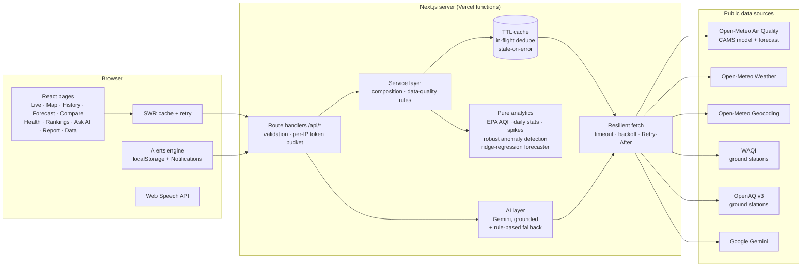

# Saans — Architecture

Saans is a single Next.js 16 application: a React client plus server-side route handlers that act as a
**backend-for-frontend (BFF)**. The browser never talks to third-party APIs directly — every upstream call goes
through our server, which owns keys, caching, rate limiting, normalisation and provenance labelling.

## Layers

| Layer | Location | Responsibility |
|---|---|---|
| Domain (pure) | `src/lib/aqi.ts`, `src/lib/analytics/*` | EPA AQI breakpoints & unit conversion, category guidance, daily aggregation, spike & anomaly detection, ML forecaster. No I/O; unit-tested. |
| Providers | `src/lib/server/providers/*` | One adapter per upstream API. Each normalises to shared types (`Snapshot`, `HourPoint`, `MapPoint`) and tags **provenance** (`measured` / `model` / `forecast`). |
| Infrastructure | `src/lib/server/http.ts`, `cache.ts`, `guard.ts` | Timeouts, retries with exponential backoff + jitter, `Retry-After` on 429, TTL cache with in-flight de-duplication and stale-on-error, per-IP token-bucket rate limiting, input validation. |
| Service | `src/lib/server/service.ts`, `narrative.ts` | Composes providers per use case and applies data-quality rules (station freshness and distance, headline selection, warnings). |
| AI | `src/lib/server/ai.ts` | Gemini calls grounded on a DATA block of fetched numbers; deterministic rule engine when no key / quota exhausted. |
| API | `src/app/api/*/route.ts` | Thin handlers: validate → rate-limit → service → JSON with CDN `Cache-Control`. |
| UI | `src/app/*/page.tsx`, `src/components/*`, `src/lib/client/*` | Client pages using SWR; location & alerts contexts; shared design system. |

## Key design decisions

**1. Provenance is a field, not a footnote.** Every value carries `kind: measured | model | forecast | predicted`
and a `source` with attribution. The UI renders a `KindBadge` next to numbers, forecasts are drawn dashed past a
"Now" line, and ML output has its own colour. This directly enforces the rule that fabricated or estimated values
are never presented as live measurements.

**2. Honest headline selection.** The headline AQI is the nearest *fresh* ground station (≤ 25 km, ≤ 3 h old).
Otherwise it falls back to the CAMS model and says so. Stations that are too far or stale are still shown, with a warning.

**3. Works with zero keys, gets better with keys.** Open-Meteo needs no key, so the app is fully functional out of
the box. `WAQI_TOKEN`, `OPENAQ_API_KEY` and `GEMINI_API_KEY` each unlock an additional authentic source. Providers
fail independently via `Promise.allSettled`.

**4. Never invent data under failure.** Failure paths are: retry → serve last good value flagged `stale` → show an
explicit error with Retry. There is no code path that substitutes a placeholder number.

**5. Consistent AQI.** Model sub-indices come from Open-Meteo's own per-pollutant US AQI (EPA averaging periods), so they
match its headline. Our EPA implementation (2024 PM2.5 breakpoints) is used where we compute AQI ourselves (OpenAQ
concentrations, ML predictions). WAQI publishes sub-indices, not concentrations, so we never label them µg/m³.

**6. Cost and quota control.** The cache is keyed by a ~1 km grid. TTLs are 10 min for current data and 1 h for
history, forecast and AI insights. CDN `s-maxage` provides a shared layer across serverless instances, and the 66 city
snapshots are fetched in one batched request. The AI routes have tighter rate limits to protect the Gemini free tier.

## ML forecaster

`src/lib/analytics/predict.ts`. Autoregressive ridge regression on `log1p(PM2.5)`.

- **Features:** lags of 1/2/3/24 h, the trailing 24 h mean, wind speed, log boundary-layer (mixing) height, humidity,
  temperature, rain, and hour of day (sin/cos).
- **Training:** about 2,200 hourly rows (92 days) per location, done on demand in about 10 ms, then cached for 1 h.
  The closed-form solve uses standardised features. The penalty scales with *n*, near-constant features are
  neutralised, and recursive predictions are clamped to a plausible band. These guards were added after a unit test
  exposed a numerical blow-up.
- **Forecasting:** recursive multi-step forecasts up to 72 h, using the *weather forecast* as future covariates.
  PM2.5 is converted to AQI via its 24 h rolling mean.
- **Evaluation:** a back-test on a held-out 72 h window from several origins. MAE is reported against two baselines,
  persistence and "same as yesterday". If the model doesn't beat persistence, the UI says so.
- **Explainability:** standardised feature weights are shown as a chart.

## Anomaly & spike detection

- **Anomalies (hourly):** a robust z-score `0.6745·(x − median) / MAD` over a trailing 48 h window. An hour is flagged
  when |z| ≥ 3.5 *and* the absolute deviation is ≥ 10 µg/m³. Consecutive hours collapse into one episode.
- **Spike days:** daily max ≥ 1.5× the median of the prior 7 daily averages (and ≥ 100), or a jump of 2+ AQI categories.
- **Forecast spikes:** future hours ≥ 1.4× now (and ≥ 100), or crossing into Unhealthy.

## Testing

`npm test` runs the Node built-in test runner directly on TypeScript sources: EPA reference values, unit conversion,
invalid-input handling, spike detection, anomaly detection, cleanest-window search, ridge correctness, and the
forecaster beating persistence. (Vitest's native binaries are blocked on the dev machine, so tests use `node:test`
with a small resolver hook in `scripts/test-resolver.mjs`.)
