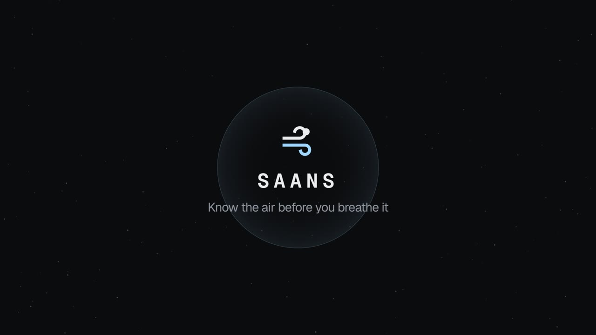
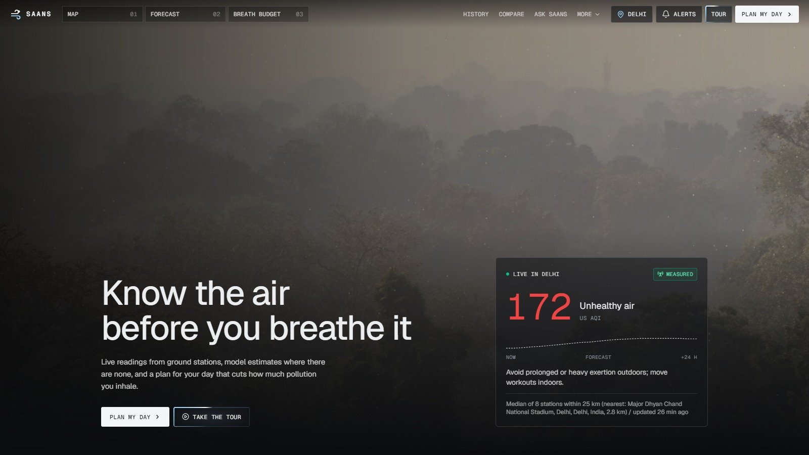
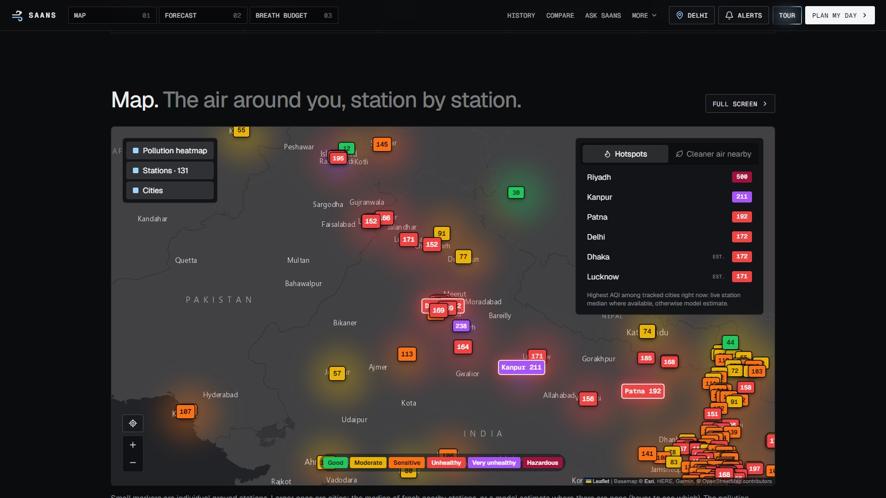
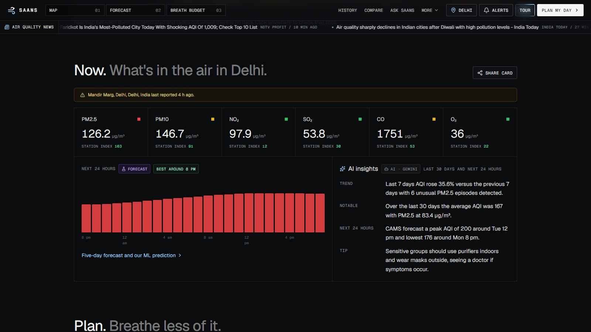
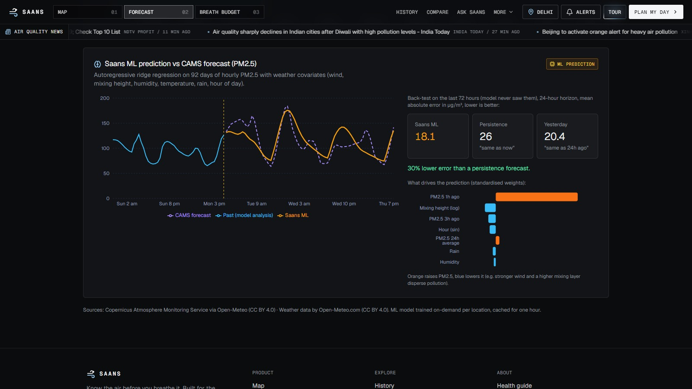
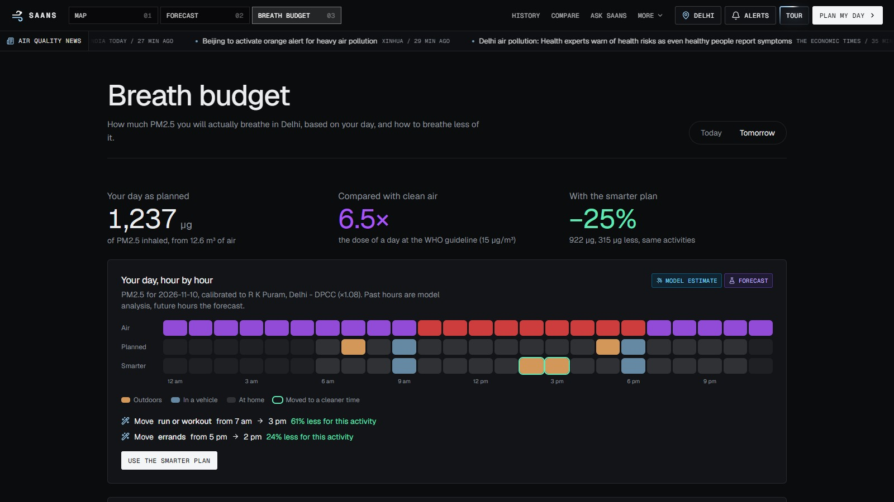
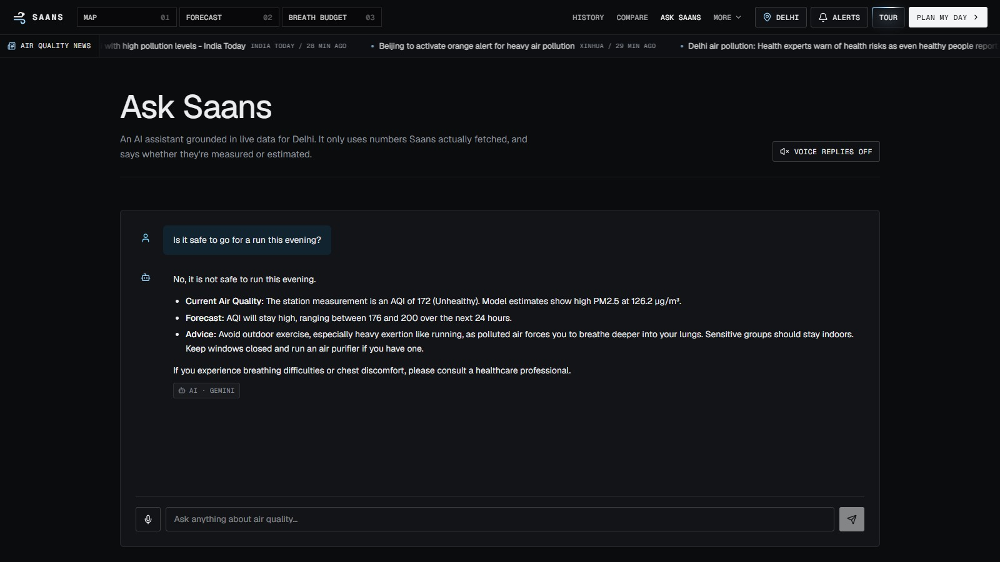
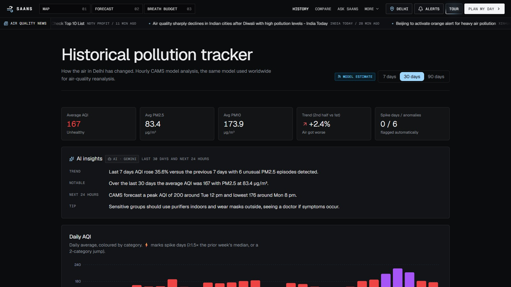
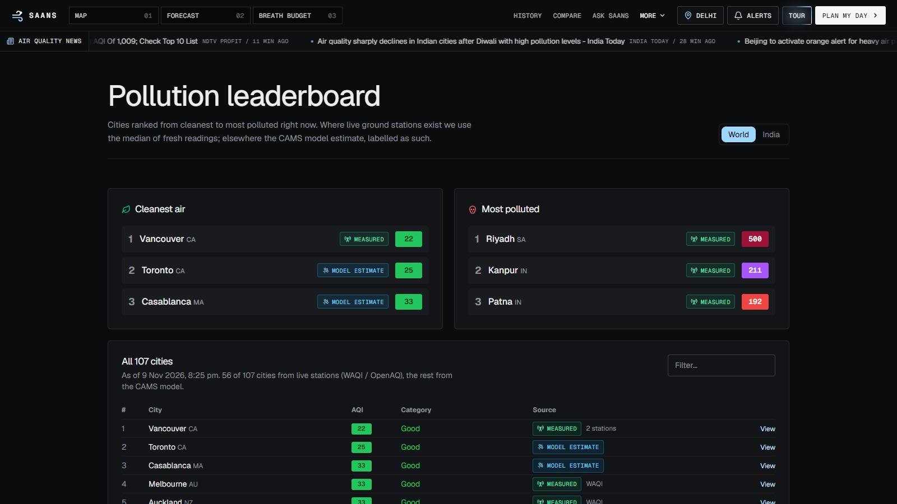

# Saans: know the air before you breathe it

> *Saans* (साँस) means "breath". **Breathe Better**.

Saans is a real-time air quality intelligence platform. It turns data from **8 authentic public sources** into answers people can act on: *What is the air like right now? Is it safe to run this evening? Where is it cleaner? Is my city getting better or worse?*

Every number on screen says where it came from: **Measured** (ground station), **Model estimate** (CAMS), **Forecast** or **ML prediction**. Saans never presents an estimate, a placeholder or a stale reading as a live measurement.

**Live app:** _add Vercel URL_ &nbsp;|&nbsp; **Demo video:** [docs/demo/Saans_Demo.mp4](docs/demo/Saans_Demo.mp4) (2:28) &nbsp;|&nbsp; **Architecture:** [ARCHITECTURE.md](ARCHITECTURE.md)

[](docs/demo/Saans_Demo.mp4)

---

## Contents
- [What makes Saans different](#what-makes-saans-different)
- [Screenshots](#screenshots)
- [Data accuracy](#data-accuracy-how-saans-decides-what-number-to-show)
- [Features: mandatory and bonus](#features)
- [Public APIs integrated](#public-apis-integrated)
- [Architecture and technology](#architecture-and-technology)
- [Run locally](#run-locally)
- [Deploy](#deploy-vercel)
- [Testing](#testing)
- [Project structure](#project-structure)
- [Credits](#credits)

---

## What makes Saans different
| | |
|---|---|
| **Station consensus, not one sensor or a model's guess** | Your headline AQI is the **median of every fresh ground station within 25 km**. Readings are sanity-checked against an independent model, and stale stations are hidden. On the night we tested, the CAMS model said Mumbai was 226 while the stations measured 99. |
| **Breath budget** (`/budget`) | A city's AQI isn't what you breathe; your day is. Saans turns your schedule into the **PM2.5 dose you'll actually inhale**, using hourly forecasts, EPA breathing rates per activity and indoor/vehicle infiltration. It then **moves flexible plans to cleaner hours** ("move your run from 7 am to 3 pm: 61% less"). |
| **Our own ML model, honestly evaluated** | A ridge-regression forecaster trained per location on 92 days of PM2.5 plus weather. It is back-tested on data it never saw, and lowered error by about 30% versus a persistence forecast in our tests. |
| **Pollution heatmap** | An interpolated surface drawn between live readings on the map, which fades out where there is no data. |
| **Live air-quality news ticker** | The latest air-quality headlines worldwide (GDELT + Google News). It pauses on hover with a preview card; click to open the article. |
| **A photo that shows the air** | The hero photograph's haze and drifting dust are set by the live AQI and PM2.5 of your place. |
| **Guided product tour** | Twelve steps across pages, started on first visit or from the glowing *Product tour* button. |

## Screenshots
| | |
|---|---|
|  **Home.** Live reading (station median), haze driven by PM2.5, news ticker |  **Map.** Live stations, city medians, pollution heatmap, hotspots |
|  **Right now.** All six pollutants, 24 h forecast, AI insights |  **Forecast + ML.** CAMS forecast vs our model, back-test, feature weights |
|  **Breath budget.** Personal dose, hour-by-hour plan, smarter timing |  **Ask Saans.** Grounded AI answers, by text or voice |
|  **History.** AI insights, daily AQI, spikes and anomalies |  **Rankings.** 107 cities, measured wherever stations exist |

## Data accuracy (how Saans decides what number to show)
1. **Headline AQI for your place:** the **median of all WAQI ground stations within 25 km that reported in the last 3 hours** (6-hour fallback). A median of several monitors is more representative than one station and resists a single faulty sensor. With no fresh station, the CAMS model value is shown and labelled *Model estimate*.
2. **City rankings, hotspots and map cities:** the same station median per city, built from a few regional WAQI requests (WAQI rate-limits bursts of small calls). The most-polluted cities get a second, precise lookup, with **OpenAQ** as a second measured source where WAQI has no coverage.
3. **Sanity checks:** a single station is accepted only if it reads 0.4 to 2 times the independent CAMS value. This rejected a faulty 500 reading for Dhaka and an implausible 142 for Singapore. Stations silent for more than 6 hours are hidden, and AQI is capped at the scale's 500 maximum.
4. **Transparency:** each value shows its provenance badge, source, distance and time. The Data page lists every provider and its live status.
5. **Reliability:** every upstream call has a timeout, retries with backoff and `Retry-After` handling. Responses are cached per ~1 km cell with in-flight de-duplication. When a provider fails, the last good value is served and flagged *stale*, never replaced with an invented number.

## Features

### Mandatory (all 6)
| Feature | Where | Highlights |
|---|---|---|
| A. Live AQI dashboard | `/` | Real-time AQI (station median), category, PM2.5 / PM10 / NO₂ / SO₂ / CO / O₃, source and last-updated time, weather |
| B. Interactive map | `/` and `/map` | Colour-coded AQI markers (stations + cities), pollution heatmap, click **anywhere** to inspect, hotspots, layer toggles |
| C. Historical tracker | `/history` | 7/30/90-day daily AQI, PM2.5 vs PM10, day-over-day % change, spike days, two-date comparison, anomalies |
| D. Location comparison | `/compare` | Up to 4 places, pollutant differences with %, 30-day trend overlay, "Cleanest" by 30-day average |
| E. Health & safety | `/health` | Category meanings, precautions, sensitive groups, PM2.5/PM10 impact, activity planner |
| F. AQI forecast | `/forecast` | 5-day daily and hourly forecast, clear "Now" divider, forecast spikes, best time to go outside |

### Bonus (all 13)
| # | Feature | Where / how |
|---|---|---|
| 1 | AI AQI Assistant | `/assistant`: Gemini answers grounded only in fetched numbers; rule-based fallback |
| 2 | Smart AQI Alerts | Header bell: per-place thresholds, browser notifications, re-arms after AQI recovers |
| 3 | ML-Based Prediction | Ridge regression on PM2.5 + weather, recursive 72 h forecast, back-test vs baselines, feature weights |
| 4 | Pollution Heatmap | Interpolated layer on the map |
| 5 | Location-Based AQI | "Use my current location" (geolocation); first visit defaults to your timezone's city |
| 6 | Clean Air Finder | Map tab "Cleaner air nearby" (within 400 km) and the cleanest time window today |
| 7 | AQI Sharing Cards | Server-rendered 1200×630 PNG, Web Share API or download |
| 8 | Pollution Impact Report | `/report`: automated analysis, WHO comparison, cigarette-equivalent, print to PDF |
| 9 | Pollution Leaderboard | `/leaderboard`: World / India rankings with podiums and provenance per city |
| 10 | Voice Assistant | Speech-to-text questions and spoken answers (Web Speech API) |
| 11 | Anomaly Detection | Robust z-score (median/MAD) episodes on hourly PM2.5 |
| 12 | Multi-API Integration | 8 public sources (below) |
| 13 | AI Insights | Four-line summary (Trend / Notable / Next 24 hours / Tip) on Home and History |

**Extras:** Breath budget, live AQI news ticker, station-consensus AQI, guided product tour, data-driven hero photo.

## Public APIs integrated
| API | Used for | Key |
|---|---|---|
| [WAQI / aqicn.org](https://aqicn.org/api/) | Live ground-station AQI, station consensus, map stations | `WAQI_TOKEN` |
| [OpenAQ v3](https://docs.openaq.org/) | Ground-station concentrations (µg/m³), second measured source | `OPENAQ_API_KEY` |
| [Open-Meteo Air Quality](https://open-meteo.com/en/docs/air-quality-api) (Copernicus CAMS) | Model AQI and pollutants, 92-day history, 5-day forecast | none |
| [Open-Meteo Weather](https://open-meteo.com/en/docs) | ML covariates (wind, mixing height, humidity, temperature, rain), current weather | none |
| [Open-Meteo Geocoding](https://open-meteo.com/en/docs/geocoding-api) | City search | none |
| [Google Gemini](https://ai.google.dev/) | Assistant and AI insights | `GEMINI_API_KEY` |
| [GDELT DOC 2.0](https://blog.gdeltproject.org/gdelt-doc-2-0-api-debuts/) | Air-quality news headlines | none |
| [Google News RSS](https://news.google.com/) | Second headline source, merged and deduplicated | none |

Keys are optional and stay server-side in environment variables. The app runs on the keyless sources alone, and each key adds a source.

## Architecture and technology
```
Browser (React 19 · Leaflet · Recharts · SWR)
   │  only talks to our own API, never to providers directly
   ▼
Next.js 16 route handlers: backend-for-frontend
   validation · per-IP rate limits · TTL cache + in-flight dedupe · CDN cache headers
   │
   ├─ Service layer: station consensus · sanity checks · headline selection · warnings
   ├─ Analytics (pure, unit-tested): EPA AQI · daily stats · spikes · anomalies · ridge ML · exposure model
   ├─ AI layer: Gemini grounded on fetched numbers · rule-based fallback
   └─ Providers: WAQI · OpenAQ · Open-Meteo (AQ / weather / geocoding) · GDELT · Google News
        resilient fetch: timeouts · retries + backoff · Retry-After · stale-on-error
```
Full details (layers, design decisions, ML method, anomaly detection): **[ARCHITECTURE.md](ARCHITECTURE.md)**.

**Stack:** Next.js 16 (App Router, TypeScript) · React 19 · Tailwind CSS 4 · SWR · Leaflet + react-leaflet · Recharts · `next/og` · Web Speech and Notifications APIs · Node test runner.

## Run locally
```bash
git clone https://github.com/CarolDsillva/saans.git && cd saans
npm install
cp .env.example .env.local   # optional: add keys (see table above)
npm run dev                  # http://localhost:3000
```
Production build: `npm run build && npm start`.

> **Styles build note:** `npm run dev` / `npm run build` first compile `src/app/globals.css` with Tailwind's Node API (`scripts/tw-build.mjs`) into `styles.generated.css`. Tailwind's usual loader relies on a native file scanner that Windows Application Control blocks on some machines; this way the output is identical on every OS.

## Deploy (Vercel)
1. Import the GitHub repo at [vercel.com/new](https://vercel.com/new) (framework preset: Next.js).
2. Add `WAQI_TOKEN`, `OPENAQ_API_KEY`, `GEMINI_API_KEY` and `GEMINI_MODEL` (e.g. `gemini-3.5-flash-lite`) as environment variables.
3. Deploy. No database or other services are needed.

## Testing
`npm test` runs **17 unit tests** with Node's built-in runner. They cover:
- EPA AQI breakpoints and unit conversions, including rejecting invalid input
- spike and anomaly detection, and the cleanest-window search
- ridge-regression correctness, and the forecaster beating persistence
- the breath-budget dose model and optimiser
- the station-consensus median and freshness rules

## Project structure
```
src/
  app/                pages (/, map, forecast, history, compare, health, budget, assistant, leaderboard, report, sources)
  app/api/            route handlers: current, history, forecast, cities, map, search, insights, assistant, news, card, status
  components/         AppShell, AirMap/MapView, NewsTicker, Tour, Insights, HazePhoto, ui
  lib/aqi.ts          EPA AQI maths and health guidance
  lib/analytics/      stats, anomalies, ML forecaster, exposure (breath budget)
  lib/server/         http, cache, guard, service, ai, narrative, providers/*
  lib/client/         location, alerts, hooks, formatting
scripts/              tw-build (styles), dev runner, test resolver
docs/                 screenshots and demo video
```

## Credits
Data: Copernicus Atmosphere Monitoring Service via Open-Meteo (CC BY 4.0); the World Air Quality Index Project and originating monitoring agencies; OpenAQ; GDELT Project; Google News; © OpenStreetMap contributors; Esri basemap.
Photography: Johan Mouchet, Ahmer Kalam and vegonaise on Unsplash.
Health guidance follows US EPA AirNow messaging and WHO 2021 guidelines. Saans is not medical advice.
